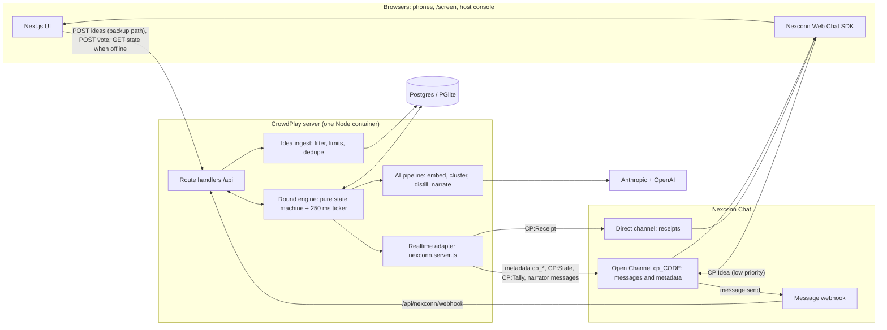

# CrowdPlay

**The audience writes the show.** A live room where everyone types at once. Within seconds AI turns the storm of ideas into three choices written by the crowd (one is always a minority "wildcard"). The room votes, the story turns, and the people whose ideas were used are credited by name on the big screen and on their own phone. All real-time delivery runs on **Nexconn Chat** (Open Channels).

Built for the Nexconn Build Challenge 2026, track **Gaming & Live Streams**.

## Links

Fill these in before submitting (see [Before submitting](#before-submitting)). The repo is public; nothing else below is deployed or recorded yet.

```
Live app:          <add after deploy>
Judge Mode (/try): <add after deploy>/try
Repo:              https://github.com/Bhavya-Dhoot/crowdplay
Demo video:        <add after upload>   (3:00 max, public or unlisted)
Write-up PDF:      <export docs/WRITEUP.md to PDF>
Nexconn App Key:   <add: the public App Key, never the App Secret>
20-second GIF:     <add docs/demo.gif after recording a real or labelled-bot session>
```

## Problem

In a live room of more than about 50 people, chat stops being a conversation: messages scroll past unread. The usual fixes silence the crowd (slow mode, emote-only) or hand control to the host (a poll whose options the host wrote). The quiet person with the best idea is never heard. The project's PRD cites research on 1.28 billion Twitch messages (Nematzadeh et al., Royal Society Open Science, 2019) showing that per-person participation falls as the crowd grows.

## What it does

Every round of a show runs the same loop inside one Nexconn Open Channel. Default timings are below; the host can change storm and vote lengths.

| # | Phase | Default length | What happens |
|---|---|---|---|
| 1 | PROMPT | 6 s | The narrator sets the scene and asks "What happens next?" |
| 2 | STORM | 30 s | Everyone types ideas (140 characters max, one every 2 s, 12 per round). Ideas rain onto the big screen. |
| 3 | DISTILL | up to 8 s (hard cap 10 s) | AI groups the ideas and writes three options: two from the crowd's largest groups and one wildcard from a small group. |
| 4 | VOTE | 12 s | One tap per person, changeable until the timer ends. Live bars. |
| 5 | REVEAL | 12 s | The narrator continues the story and credits contributors ("@priya, @sam + 23 others"). Credited phones get a receipt. |
| 6 | next round or FINALE | - | After the last round: story recap, canon makers, a shareable `/story/<id>` page with an OG image. |

What is new, in three parts: **options written by the crowd** (nobody scripts the choices), a **guaranteed minority slot** (the wildcard comes from a group holding 15% of the ideas or fewer), and **personal receipts** ("your idea is on the ballot", "your idea became canon", kept on `/me`). Counts and credits are always computed from the database, never taken from the model.

Six story presets (Heist, Fantasy Quest, Space Mission, Murder Mystery, Classroom "What if?", Custom), 3 to 10 rounds, host console with veto / re-roll / force-win / mute / ban, big screen with an OBS overlay mode, and Judge Mode with 30 labelled bot players.

## Feature to Nexconn

The same table is on `/how-it-works`. Only `src/lib/realtime/nexconn.server.ts` and `src/lib/realtime/nexconn.client.ts` import Nexconn packages (`nexconn.codec.ts` is the shared message encoder/decoder).

| Feature | Nexconn capability |
|---|---|
| Zero-signup join | Server API access-token issue + Web Chat SDK connect |
| The live room | Open Channel `cp_<CODE>` (unlimited participants, online-only) |
| Idea storm | Custom message `CP:Idea`, registered as low priority |
| Everyone sees the same phase and countdown | Open Channel metadata (`cp_phase`, `cp_prompt`, `cp_options`, `cp_outcome`, `cp_stats`, `cp_story`) + priority message `CP:State` |
| Live vote bars | Open Channel metadata `cp_tally` + `CP:Tally` |
| Narrator and bots | Server-sent Open Channel messages from registered users (`cp_narrator`, bot users); priority sender list |
| "Your idea became canon" | Direct Channel message `CP:Receipt` from `cp_narrator` (system channel as fallback) |
| Moderation | Open Channel mute/ban lists, profanity word list |
| Server learns about messages | Message webhook (`message:send`), signature-checked and deduplicated |
| Reconnect banner | Connection status handler |

This mapping was built from the installed SDK type definitions and docs.nexconn.ai. On 2026-11-17 it was run against a live Nexconn app (Singapore data center): smoke test 11/11, plus three full rounds with headless browsers in which custom `CP:*` messages, state updates and narrator receipts reached the clients. The status of every open question is in [docs/NEXCONN_FINDINGS.md](docs/NEXCONN_FINDINGS.md) (U1 to U10). See [Limitations](#limitations).

## Architecture



- **Server time is authoritative.** The engine is deadline-driven and idempotent (`advance(roomId)` can be called by the ticker, by every state read and by the host heartbeat and still produces one transition per deadline). State survives a restart because it lives in the database.
- **One `PublicState` shape** reaches clients three ways, merged by highest version: Nexconn metadata, the priority `CP:State` message, and `GET /api/rooms/<CODE>/state` (polled every 2 s only while Nexconn is disconnected).
- **Votes are HTTP only** (secret, deduplicated, authoritative). Everything players see still arrives through Nexconn.
- **AI pipeline, with fallbacks at every step:** embeddings (OpenAI, 2.5 s) fall back to local hashed vectors; the distiller (Anthropic fast model, 5 s) falls back to the OpenAI fast model (3 s), then to heuristics; the narrator and finale (Anthropic smart model, then fast model, then a template). A 10 s hard cap forces the heuristic path so no round stalls.
- **Safety in layers:** word filter at ingest (plus Nexconn's profanity list), LLM safety flags and a re-filter of everything the model writes, then host veto / delete / mute / ban.

More detail: [docs/TECH_SPEC.md](docs/TECH_SPEC.md), [docs/NEXCONN_INTEGRATION.md](docs/NEXCONN_INTEGRATION.md), [docs/DECISIONS.md](docs/DECISIONS.md), and the in-app `/how-it-works` page.

## How judges can test it

Replace `<APP>` with the live app URL from the Links block. For a local run use `http://localhost:3000` (see [Local setup](#local-setup)).

### A. Alone, about two minutes for the whole demo: `/try`

1. On `<APP>/` press **Play a 2-minute demo**. It opens `/try?go=1`, which gives you a random name (editable in the banner) and starts at once. Plain `<APP>/try` shows a short intro with a name field and **Start the demo** instead.
2. A banner stays on screen and says the room is a demo with 30 simulated players. The bots wear a 🤖 everywhere. On a laptop the phone panel is on the left and a mini big screen on the right; on a phone the big screen opens from a banner icon.
3. Three paper tips under the phone guide you: **Type any idea** (storm, 20 s), **Watch it compete** (your idea joins about 60 bot ideas and the AI writes three options), **Vote** (the vote closes about 1.5 s after you vote).
4. Your idea gets a demo-only boost into the wildcard slot, tagged "⚡ boosted in demo", and the label is your own words credited to you alone. Until you have had one winning idea in the show, the bots' votes lean toward your wildcard (a soft nudge in round 2, a sure win in round 3), so a first-time judge sees the full-screen "Your idea became canon" moment and the receipt on `/me`. The tag's explainer says so. Your own vote is never changed, and live shows have no boost and no lean.
5. The reveal lasts as long as the narration takes to read (8 to 15 s). After round 3 an end card links to the story, Host a show, How it works and Impact. Measured length from the landing click to the finale: about 107 s with the engine's timers, 120 to 127 s when played by hand in a browser.

Bots and demo rooms are excluded from `/impact` by construction.

### B. Two devices: host on a laptop, player on a phone

1. Laptop: open `<APP>/host`. Pick a story (six presets; title and premise are prefilled and editable) and press **Create show**. Everything else has a default: a one-line **Pace and rules** summary opens to change rounds (3 to 10), storm (20 / 30 / 45 s), vote (10 / 12 / 20 s), auto-advance and the strict filter, and your host name is prefilled with a dice button. You land on `/host/<CODE>?k=<host key>`. Keep that URL private: the key runs the show.
2. In the lobby a **Get people in** card fills the centre: a large QR code, the 5-letter code, **Copy join link**, and chips for the screen, OBS and host links. Once the show starts the card moves, smaller, to the **Room** column. **Big screen** in the top bar opens `/screen/<CODE>`; put it on a projector or share the window.
3. Phone: scan the QR (it opens `/join/<CODE>`), enter a name, press **I'm in**. More players: more phones, or separate incognito windows (one browser profile is one player).
4. Laptop: press **Start show**. The yellow key then follows the phase (Start storm now, End storm now, Reveal now, Next round, Finale, End show), and a timeline under it marks the round and phase. During VOTE you can **Veto** an option (replaced within seconds), **Force win**, or **Re-roll** once. Players can be muted or banned and ideas deleted at any time.
5. After the finale, open the story page (`/story/<showId>`, linked from the host console) and, on the phone, `/me` for receipts.

### C. OBS overlay

Add a Browser Source in OBS with URL `<APP>/screen/<CODE>?obs=1`, 1920 x 1080. The background is transparent and the QR is hidden; add `&qr=1` to bring the QR back.

### D. Other things worth opening

`/how-it-works` (loop, architecture, the Feature to Nexconn table, limits), `/impact` (real usage, bots and demo rooms excluded; it says plainly when nothing has been played), `/api/health` (modes and database), `/me` (receipts, "Delete my data").

## Local setup

Requirements: Node 22 or newer, pnpm 10 (`corepack enable` picks the version pinned in `package.json`), and internet access for the first `pnpm install` (the Nexconn server SDK is a GitHub dependency) and for `pnpm build` (`next/font` downloads Kalam and Patrick Hand and self-hosts them).

```bash
git clone https://github.com/Bhavya-Dhoot/crowdplay.git
cd crowdplay
pnpm install
pnpm dev          # http://localhost:3000
```

- **`pnpm install` has a postinstall step.** `@nexconn/server-sdk` is not on npm; it is installed from `github:NexconnAI-Dev/nexconn-server-sdk-node#v0.1.2`, and that package ships only TypeScript sources. `scripts/build-nexconn-server-sdk.mjs` compiles its `dist/` in place with `tsc`, and `pnpm-workspace.yaml` allow-lists the package's build step. If you ever see `Cannot find module '.../dist/index.js'`, run `node scripts/build-nexconn-server-sdk.mjs`.
- **`pnpm dev` works with no credentials.** With no `.env` the defaults are `REALTIME_MODE=mock` and `LLM_MODE=mock`: an in-process message bus over SSE (`/api/mock/stream`), a deterministic mock distiller and narrator, local hashed-vector clustering, and an embedded PGlite database at `./.data/pglite`. `/try`, hosting, and several browser windows all work this way.
- **Do not copy `.env.example` unchanged for credential-less work.** It is written for deployment: it sets `REALTIME_MODE=nexconn` and `LLM_MODE=live`, and the server then refuses to boot without the Nexconn variables. For local mock work either skip `.env` or copy it and set `REALTIME_MODE=mock` and `LLM_MODE=mock`.
- **Faster demos:** `TIMING_SCALE=0.2 pnpm dev` shortens every phase (each phase is at least 1 s). It is a test and demo knob; never set it in production.
- **Live services locally:** set `REALTIME_MODE=nexconn`, `LLM_MODE=live` and the credentials. Nexconn cannot call `localhost`, so also set `INGEST_MODE=post` (ideas then reach the server over HTTP; players still see each other's ideas through Nexconn) or expose the webhook through a tunnel.
- **Live checks you can run once credentials exist:** `pnpm smoke:nexconn` (server-side checks U1 to U10, appends results to `docs/NEXCONN_FINDINGS.md`) and a two-browser show with `REALTIME_MODE=nexconn LLM_MODE=live pnpm build && REALTIME_MODE=nexconn LLM_MODE=live pnpm start`.

## Environment variables

Copy `.env.example` to `.env` (Next.js also reads `.env.local`). Empty values count as unset. Never commit real values; `.env*` is git-ignored and Docker-ignored.

| Variable | Default in code | What it does | Needed when |
|---|---|---|---|
| `REALTIME_MODE` | `mock` (`.env.example` says `nexconn`) | `nexconn`: all real-time delivery over Nexconn. `mock`: in-memory bus + SSE for tests and credential-less dev. The server **refuses to start** in production with `mock`. | Production: `nexconn` |
| `LLM_MODE` | `mock` (`.env.example` says `live`) | `live`: Anthropic / OpenAI calls. `mock`: deterministic distiller, narrator and bots, no network. `live` with no usable key behaves like `mock`; `/api/health` then reports `llmMode: "mock"`. | Live AI: `live` + at least one key |
| `INGEST_MODE` | `dual` | How the server hears about ideas. `dual`: Nexconn message + HTTP POST, deduplicated. `webhook`: Nexconn message only (needs the webhook). `post`: HTTP POST only as the server's source (no webhook needed). | Optional; use `post` if the webhook cannot reach you |
| `ALLOW_MOCK_IN_PROD` | `0` | Escape hatch for a local production build with the mock transport (the e2e suite uses it). Also waives the production `SESSION_SECRET` check. Never set it on a real deployment. | Local production test only |
| `NEXCONN_APP_KEY` | - | Nexconn App Key (server side). | `REALTIME_MODE=nexconn` (checked at boot) |
| `NEXCONN_APP_SECRET` | - | Nexconn App Secret. Signs server API calls and webhook checks. Server only. | `REALTIME_MODE=nexconn` (checked at boot) |
| `NEXCONN_PRIMARY_API_DOMAIN` | - | Server API base URL of your data center, e.g. `https://api.<region>...` from the console. | `REALTIME_MODE=nexconn` (checked at boot) |
| `NEXCONN_SECONDARY_API_DOMAIN` | - | Backup API domain; the SDK fails over to it. | `REALTIME_MODE=nexconn` (checked at boot) |
| `NEXT_PUBLIC_NEXCONN_AREA` | - | Web SDK data-center code: an `AreaCode` key (`BJ`, `SG`, `NA`, `SA`, `OM`) or its number. Must match the App Key's data center and the API domains. Also a Docker build arg. | `REALTIME_MODE=nexconn` |
| `NEXCONN_WEBHOOK_SECRET` | - | If set, replaces the App Secret as the webhook signing secret. | Only if the console gives a separate one |
| `NEXCONN_TEXT_ENVELOPE` | `0` | `1`: send `RC:TxtMsg` envelopes instead of `CP:*` custom types (fallback if custom types do not reach Web clients). | Only if the live two-browser show proves it is needed |
| `ANTHROPIC_API_KEY` | - | Distiller, narrator, scene prompts, finale, bot ideas. | `LLM_MODE=live` (this or the OpenAI setup) |
| `ANTHROPIC_FAST_MODEL` | `claude-haiku-5-5` | Model id for the distiller, bot ideas and translation. Check the id against the provider's model list. | Optional |
| `ANTHROPIC_SMART_MODEL` | `claude-sonnet-5-5` | Model id for the narrator, scene prompts and finale. | Optional |
| `OPENAI_API_KEY` | - | Embeddings for clustering, fallback LLM, optional TTS. Without it clustering uses local hashed vectors. | Recommended with `LLM_MODE=live` |
| `OPENAI_EMBED_MODEL` | `text-embedding-3-small` | Embedding model id. | Optional |
| `OPENAI_FAST_MODEL` | - | Fallback LLM when the Anthropic step fails. The OpenAI step is skipped while empty. | Optional (needs `OPENAI_API_KEY`) |
| `OPENAI_TTS_MODEL` | - | TTS model id. | `FEATURE_TTS=1` |
| `OPENAI_TTS_VOICE` | `alloy` | TTS voice. | Optional |
| `APP_URL` | `http://localhost:3000` | Public base URL. Builds the join / screen / OBS / host links and QR codes; an `https://` value makes the session cookie `Secure`. | Production: set to the public https URL |
| `SESSION_SECRET` | dev-only fallback outside production | HS256 secret for guest session tokens, 32+ random characters. | Production (boot fails without it) |
| `ADMIN_TOKEN` | - | Enables `/admin?token=...` and the CSV export. Unset means admin is off. | Optional |
| `DATABASE_URL` | - (embedded PGlite at `./.data/pglite`) | Postgres connection string. Migrations run on boot. | Production (PGlite is for single-process dev) |
| `FEATURE_TTS` | `0` | Narrator voice on the big screen. | Optional |
| `FEATURE_MULTILINGUAL` | `0` | Players pick a language; options and narration are translated for them. | Optional |
| `FEATURE_CHEERS` | `1` | Emoji cheers (low priority, never block the UI). | Optional |
| `PROMPT_MS` | `6000` | Default PROMPT length. | Optional |
| `STORM_MS` | `30000` | Default STORM length (the host's choice per show overrides it). | Optional |
| `VOTE_MS` | `12000` | Default VOTE length (the host's choice per show overrides it). | Optional |
| `REVEAL_MS` | `12000` | Default REVEAL length. | Optional |
| `DISTILL_HARD_CAP_MS` | `10000` | Hard cap on DISTILL before the no-LLM path is forced. | Optional |
| `ROOM_PLAYER_CAP` | `450` | Maximum players per room; keeps headroom under the 500-connection plan limit. | Optional |

More variables (the first five are in `.env.example`; the rest are for tests, builds and hosting):

| Variable | Default | What it does |
|---|---|---|
| `DISTILL_BUDGET_MS` | `8000` | Time the AI chain gets inside DISTILL before heuristics take over. |
| `TIMING_SCALE` | `1` | Multiplies every phase duration (above 0, at most 1; each phase stays at least 1 s). Tests and demos only. |
| `PGLITE_DIR` | `./.data/pglite` | Where the embedded database lives when `DATABASE_URL` is empty. |
| `LOG_LEVEL` | `info` | pino log level (`silent` under tests). |
| `NEXT_PUBLIC_REPO_URL` | - | Shows a GitHub link in the footer. Read at build time (Docker build arg). |
| `PORT` | `3000` | Port for `next start` in the Docker image. |
| `MOCK_DISTILL_DELAY_MS` | `0` | Only with `LLM_MODE=mock`: simulated distill latency (max 10 s) so DISTILL is visible in e2e. |
| `E2E_PORT` | first free of 3100–3199 | Port for the e2e server (`scripts/e2e-server.mjs`). |
| `NEXT_DIST_DIR` | `.next` | Build output folder; lets a second build (Lighthouse runs) sit beside the e2e build. |

## Scripts

| Script | Command | Use |
|---|---|---|
| `pnpm dev` | `next dev` | Dev server on :3000. |
| `pnpm build` | `next build` | Production build. |
| `pnpm start` | `next start` | Production server; applies migrations on boot. Needs `REALTIME_MODE=nexconn`, or `ALLOW_MOCK_IN_PROD=1` for a local test. |
| `pnpm typecheck` | `next typegen && tsc --noEmit` | Type check (strict). |
| `pnpm lint` | `eslint .` | Lint. |
| `pnpm test` | `vitest run` | Unit + integration tests (mock modes forced). |
| `pnpm e2e` | `playwright test` | Browser end-to-end suite. |
| `pnpm verify` | `bash scripts/verify.sh` | The full gate, see below. |
| `pnpm check:secrets` | `tsx scripts/check-no-secret.ts` | Fails if a server secret value appears in `.next/static` or prerendered output. |
| `pnpm smoke:nexconn` | `tsx scripts/nexconn-smoke.ts` | Live Nexconn checks (needs credentials; exit 0 pass, 1 a load-bearing check failed, 2 credentials missing). |
| `pnpm load:sim` | `tsx scripts/load-sim.ts` | 300 senders x 5 ideas per 30 s storm through the real ingest + engine in mock mode; `--http <baseUrl>` targets a running server. Results in `docs/load-sim-results.md`. |
| `pnpm db:generate` | `drizzle-kit generate` | Generate a migration after a schema change. |
| `pnpm db:migrate` | `tsx scripts/migrate.ts` | Apply migrations to `DATABASE_URL` (or PGlite). Also runs on server boot. |
| `pnpm seed:demo` | `tsx scripts/seed-demo.ts` | Plays one labelled demo show to its finale so `/story/<id>` has content locally. Stop `pnpm dev` first (PGlite is single-process). Demo rows never count on `/impact`. |
| `postinstall` | `node scripts/build-nexconn-server-sdk.mjs` | Builds the Nexconn server SDK's `dist/`. |

## Tests

```bash
pnpm test                         # unit + integration (Vitest; PGlite, mock realtime, mock LLM)
pnpm exec playwright install chromium   # once, for the browser the e2e suite uses
pnpm e2e                          # Playwright suite (mock modes) against the existing production build: run `pnpm build` first
pnpm verify                       # everything below, in order
```

`pnpm verify` runs `scripts/verify.sh` with `REALTIME_MODE=mock LLM_MODE=mock` and the external keys unset:

1. `pnpm typecheck`
2. `pnpm lint`
3. `pnpm test`
4. `pnpm build` with canary values for `NEXCONN_APP_SECRET`, `ANTHROPIC_API_KEY`, `OPENAI_API_KEY`, `SESSION_SECRET` and `ADMIN_TOKEN` in the environment
5. `pnpm check:secrets` against that build (proves none of the canaries reach what the browser can download)
6. `pnpm e2e`

The unit and integration suites cover the pure round state machine, tie-break, vote tally, the distiller's validator against malformed model output, clustering, the idea filter and rate limits, webhook verification, the Nexconn message codec and both Nexconn adapters (against stubs), whole shows through the API (create, join, ideas, distill, vote, reveal, finale), restart-and-resume, 20 concurrent `advance()` calls producing one transition, webhook + HTTP double delivery inserting one idea, LLM and embedding failure paths, veto and re-roll, bots excluded from `/impact`, and the story / impact / admin pages.

The real output of the latest run is in [docs/VERIFICATION.md](docs/VERIFICATION.md). This README does not repeat results.

**Measured so far (mock / synthetic only).** `pnpm load:sim` in mock mode, 300 simulated senders x 5 ideas per 30 s storm over 5 rounds: 7,500 ideas attempted, 7,500 accepted, 0 dropped; options saved a median of 927 ms and p95 of 1,161 ms after the storm closed. These are synthetic ideas on an in-process database with no LLM or Nexconn latency, so they say nothing about live delivery. Details and caveats: [docs/load-sim-results.md](docs/load-sim-results.md).

## Deploy

CrowdPlay is designed for **one long-running Node container** (the round ticker, rate limiters and embedding cache live in the process) plus a managed Postgres. Render, Railway and Fly.io all work with the included `Dockerfile` (multi-stage, Node 22, runs `next start`, `HEALTHCHECK` on `/api/health`, runs as the non-root `node` user). The Docker image was built and run locally; the platform steps below have not yet been exercised against a real account.

### Render + Neon, free tier (recommended: one Blueprint)

[`render.yaml`](render.yaml) describes the web service: Docker, free plan, `singapore` (next to Nexconn's SG data center), with the health check, the non-secret settings, and a generated `SESSION_SECRET` and `ADMIN_TOKEN`. The database is a free [Neon](https://neon.com) Postgres.

1. Neon: create a project in **AWS Asia Pacific (Singapore)** and copy its connection string as Neon shows it (the pooled one, ending in `?sslmode=require&channel_binding=require`) and paste it as it is. It gives a TLS 1.3 connection with a verified certificate; `sslmode=verify-full` is the same check without the startup warning.
2. Render dashboard: **New, Blueprint**, connect GitHub, pick `Bhavya-Dhoot/crowdplay`.
3. Render asks for four values once: `DATABASE_URL` (the Neon string), `NEXCONN_APP_KEY`, `NEXCONN_APP_SECRET` and `OPENAI_API_KEY`. Paste the values themselves: Render does not expand `$NAME` references. Press **Apply**.
4. Wait for the first build (several minutes) and open `https://<service>.onrender.com/api/health`: it should show `"realtimeMode":"nexconn"` and `"llmMode":"live"`. `APP_URL` is not needed: the app falls back to Render's `RENDER_EXTERNAL_URL`, so QR codes and share links already use the public URL.
5. Nexconn console: set the webhook URL to `https://<service>.onrender.com/api/nexconn/webhook` with `message:send` (with `INGEST_MODE=dual` ideas also arrive over HTTP, so a show works before the webhook is set).

Free-tier facts to know before a demo: the web service sleeps after 15 minutes without traffic and takes about a minute to wake (open the URL a minute before you need it); nothing is lost while it sleeps because all state is in Postgres. Neon's free plan has no 30-day expiry (Render's free Postgres does). Its compute suspends after 5 idle minutes and resumes in well under a second on the next query; while the app is awake its 250 ms round ticker keeps the compute awake too, which spends Neon's monthly allowance (100 CU-hours, about 400 hours at the smallest size) only while Render is awake. One instance only, which is what the free plan gives you.

### What every deploy needs

1. **Postgres.** Create a database (for example on Neon) and copy its connection string, including `sslmode=require`, into `DATABASE_URL`. Migrations run automatically on boot. PGlite (the empty-`DATABASE_URL` fallback) is only for single-process development.
2. **Runtime variables.**
   ```
   REALTIME_MODE=nexconn
   LLM_MODE=live
   INGEST_MODE=dual
   NEXCONN_APP_KEY=...  NEXCONN_APP_SECRET=...
   NEXCONN_PRIMARY_API_DOMAIN=https://...  NEXCONN_SECONDARY_API_DOMAIN=https://...
   NEXT_PUBLIC_NEXCONN_AREA=SG
   ANTHROPIC_API_KEY=...  OPENAI_API_KEY=...  OPENAI_FAST_MODEL=...
   SESSION_SECRET=<32+ random characters, e.g. openssl rand -hex 32>
   ADMIN_TOKEN=<random>
   DATABASE_URL=postgres://...
   APP_URL=https://<your public host>
   ```
   Do not set `ALLOW_MOCK_IN_PROD`. `NEXT_PUBLIC_NEXCONN_AREA` must be the data center of your App Key.
3. **Build args for the `NEXT_PUBLIC_*` values.** Pass `NEXT_PUBLIC_NEXCONN_AREA` and (optional, for the footer's GitHub link) `NEXT_PUBLIC_REPO_URL` as Docker build args, and also set the area as a runtime variable: the server reads it at runtime and hands it to browsers in `POST /api/session`, together with the public `NEXCONN_APP_KEY`, while `NEXT_PUBLIC_REPO_URL` is only read at build time. They are public values; secrets are never build args.
4. **Webhook.** In the Nexconn console set the webhook URL to `https://<host>/api/nexconn/webhook` and subscribe to `message:send`.
5. **Health check** path `/api/health` (returns 503 when the database is unreachable).
6. **Exactly one instance.**

`APP_URL` is only known after the first deploy: deploy, copy the public URL, set `APP_URL`, restart (no rebuild needed).

### Railway

1. Push the repo to GitHub. In Railway: **New Project, Deploy from GitHub repo**. Railway builds the root `Dockerfile`.
2. Open the service's **Variables** and paste the runtime variables above. Railway passes service variables to the Docker build for every `ARG` the Dockerfile declares, so the `NEXT_PUBLIC_*` values reach the build; confirm they are present before the first build.
3. **Settings, Networking, Generate Domain.** Copy the URL, set `APP_URL=https://<that domain>`, redeploy.
4. **Settings, Healthcheck Path:** `/api/health`. Keep replicas at 1.
5. Add the webhook URL in the Nexconn console (below), then run the post-deploy checks.

### Fly.io

1. `fly auth login`, then from the repo root:
   ```bash
   fly launch --no-deploy --name <app> --region <region near your Nexconn data center>
   ```
   Keep the existing `Dockerfile`; decline Postgres and Redis (you use Neon).
2. Make `fly.toml` look like this (public values only; secrets go in step 3):
   ```toml
   app = "<app>"
   primary_region = "<region>"

   [build]
     dockerfile = "Dockerfile"

     [build.args]
       NEXT_PUBLIC_NEXCONN_AREA = "SG"
       NEXT_PUBLIC_REPO_URL = "https://github.com/<you>/<repo>"

   [env]
     REALTIME_MODE = "nexconn"
     LLM_MODE = "live"
     INGEST_MODE = "dual"
     NEXT_PUBLIC_NEXCONN_AREA = "SG"
     APP_URL = "https://<app>.fly.dev"

   [http_service]
     internal_port = 3000
     force_https = true
     auto_stop_machines = "off"
     auto_start_machines = true
     min_machines_running = 1

     [[http_service.checks]]
       method = "GET"
       path = "/api/health"
       interval = "30s"
       timeout = "5s"
       grace_period = "30s"

   [[vm]]
     memory = "1gb"
     cpu_kind = "shared"
     cpus = 1
   ```
   The 1 GB size is a starting point, not a measured requirement.
3. Set the secrets, then deploy and pin one machine:
   ```bash
   fly secrets set NEXCONN_APP_KEY=... NEXCONN_APP_SECRET=... \
     NEXCONN_PRIMARY_API_DOMAIN=https://... NEXCONN_SECONDARY_API_DOMAIN=https://... \
     ANTHROPIC_API_KEY=... OPENAI_API_KEY=... OPENAI_FAST_MODEL=... \
     SESSION_SECRET=$(openssl rand -hex 32) ADMIN_TOKEN=$(openssl rand -hex 16) \
     DATABASE_URL='postgres://...?sslmode=require'
   fly deploy
   fly scale count 1
   ```
4. Add the webhook URL `https://<app>.fly.dev/api/nexconn/webhook` in the Nexconn console, then run the post-deploy checks.

### Nexconn console checklist

Do these once per Nexconn app (details and error codes: [docs/NEXCONN_FINDINGS.md](docs/NEXCONN_FINDINGS.md) section 4).

- [ ] Create the app and note its **data center**. The App Key, the API domains and `NEXT_PUBLIC_NEXCONN_AREA` must all belong to the same one.
- [ ] Enrol in **Chat Growth Credit** if you want the higher allowance, and send one message (the pack assumes 500 concurrent connections under it; that figure is not confirmed, see Limitations).
- [ ] **Chat, Chat settings, Open Channels:** enable the **metadata service** (otherwise error 23426) and **Open channel message priority** (otherwise error 1009). Leave "Restrict messaging to joined participants" off. Cloud retention is not needed (the server archives to Postgres).
- [ ] **Security and Moderation:** decide on "Moderate messages sent by server API" (it applies the profanity list to bots and the narrator too).
- [ ] **Chat, Chat settings, Webhooks:** URL `https://<host>/api/nexconn/webhook`, event `message:send`.
- [ ] If "Domain allowlist for Web clients" is on, add `localhost` and the deploy origin.
- [ ] Copy App Key, App Secret, both API domains (with `https://`) and the area code into the variables above.

### After deploying

```bash
curl -s https://<host>/api/health
# expect "ok":true, "realtimeMode":"nexconn", "llmMode":"live", "db":"pg"
```

If `llmMode` says `mock`, the AI keys are missing. Then, from a machine with the same Nexconn variables, run `pnpm smoke:nexconn`; then run a two-device show against the deployment (host on a laptop, a phone as player) and check, in the server logs, that ideas arrive at `/api/nexconn/webhook`; finally open `/try` in an incognito window and on a fresh phone. The first live run answers the questions still open in `docs/NEXCONN_FINDINGS.md`; record the outcome there and in `docs/VERIFICATION.md`.

## Limitations

State of verification:

- **Live Nexconn + live AI: verified on 2026-11-17 with automated browsers, not yet with people.** `pnpm live:check` passed against the real Nexconn API (Singapore data center) and OpenAI `gpt-5.4-mini`: the smoke test (11/11), the server half of the realtime contract, and three full rounds played by two headless phones and the big screen. Custom `CP:*` messages, state updates and narrator receipts all reached the browsers. Results: `docs/VERIFICATION.md` §5 and `docs/NEXCONN_FINDINGS.md`. Still untested: the message webhook (needs the deployed https URL), more than 3 concurrent clients, real phones on mobile networks, and Claude (no Anthropic key was used).
- **Live latency (3 clients, India → Singapore):** idea to another phone and to the big screen 0.93–1.04 s (13 of 14 samples; one 3.0 s outlier), so the 1 s target holds at the median, not at p95. STORM deadline → options on the phones 2.8–3.1 s with live AI (target 8 s p95). The load simulation above is still mock-only.
- **No real usage yet.** No public sessions are recorded; `/impact` reads the database and says so.
- The optional features (TTS, multilingual) have flag-off tests; flag-on needs live keys and has not been run live. In mock mode translation returns nothing, so the multilingual flag does nothing visible without live keys.

Platform limits and design trade-offs:

- **Plan limits.** Nexconn Free allows 50 concurrent open channels (ended rooms' channels are destroyed 2 minutes after the show ends; an abandoned room keeps its channel for up to 7 days of inactivity and counts against that cap). The pack assumes 500 concurrent connections under Chat Growth Credit; the public pages read only state 2,000 MAU and a connection allowance of 5% of the MAU tier (100 on plain Free), so 500 is **not confirmed**. Rooms stop admitting players at 450 by default.
- **The webhook body is not signed.** Nexconn signs `sha1(AppSecret + Nonce + Timestamp)` only, so a captured header set authenticates any body while its timestamp is accepted. The server limits the timestamp to 5 minutes, parses strictly, dedupes on the provider message id, and re-runs every idea through the same participant, phase, rate-limit and filter checks as the HTTP path. Restricting the endpoint to Nexconn's published source IPs is an optional extra.
- **Client-visible metadata can be forged by other clients.** Browsers treat metadata as a hint, accept state, tally, moderation and receipts only from `cp_narrator`, ignore implausible version jumps, and keep HTTP state authoritative.
- **The mock transport is refused in production.** `next start` aborts with `REALTIME_MODE=mock` unless `ALLOW_MOCK_IN_PROD=1`, which exists only for local production-build tests.
- **Single instance.** Rate limits, the ticker's in-flight set, ingest locks and the embedding cache are per process, so the deploy steps pin one instance. The engine takes a database row lock in `advance`, but running two instances has not been tested.
- **TTS audio is stored on the container's local disk** (`./.data/tts`) and is lost on redeploy; links to clips from earlier rounds then return 404 and the screen stays silent for them. TTS is off by default.
- **Nexconn access tokens are not refreshed** during a show; if one expires the page needs a new session.
- **The host's "Connected" counter can over-count.** It uses Nexconn's participant count when available, and Nexconn evicts offline users lazily; it falls back to players seen in the last 45 s. The player count everyone else sees is the number of players who joined the room (from the database).
- **Demo boost.** `/try` boosts the judge's idea into the wildcard slot. It is shown as "boosted in demo" and is not used in live shows.
- **Bots** exist only in demo rooms, are labelled 🤖 everywhere and are excluded from `/impact`.
- No accounts, payments, native apps or video streaming (hosts bring their own stream; the overlay is for that).

## Prior work

- No code written before the challenge window was reused. The first commit in this repository is dated **2026-11-17 01:29:43 +0530** (`git log --reverse --format=%ad --date=iso | head -1`); the history after it is the in-window evidence.
- The product spec pack (PRD, tech spec, UX spec, AI prompts, build plan; dated 15 Nov 2026) was written before the first commit. It contains no code.
- Third-party code is limited to the dependencies in `package.json`:
  - Nexconn: `@nexconn/chat` 26.2.1, `@nexconn/engine` 26.2.1, `@nexconn/server-sdk` 0.1.2 (GitHub)
  - App: Next.js 16.4.6, React 19.3.0, Tailwind CSS 4.3.3, Framer Motion, lucide-react, canvas-confetti, qrcode
  - Server: Drizzle ORM, PGlite (`@electric-sql/pglite`), `pg`, zod, jose, pino, nanoid
  - AI SDKs: `@anthropic-ai/sdk`, `openai`
  - Tooling: TypeScript, ESLint, Vitest, Playwright, tsx, drizzle-kit
  - Fonts: Kalam and Patrick Hand via `next/font/google` (the share image embeds Patrick Hand from `src/components/depth/fonts`, SIL OFL 1.1, licence file alongside)
  - Design: the visual language follows the "Sketchnote" style description in the brag video-style catalogue (hand-drawn notes on dot-grid paper, a black pen, a grey marker, one yellow marker). The hand-drawn SVG paths come from our own generators in `src/components/ui/doodle.ts`
- The idea blocklist, bot personas, canned bot ideas, story presets, prompts and every screen were written for this project. There are no bundled image or audio assets (sounds are synthesised in the browser).

## Before submitting

Placeholders that must be replaced by a human, and things only a human can do:

- [ ] Deploy (Render Blueprint above), then fill **Live app**, **Judge Mode** and **Nexconn App Key** in the Links block and in `docs/WRITEUP.md` section 1.
- [ ] Make the repo public, fill **Repo** here and in `docs/WRITEUP.md`; set `NEXT_PUBLIC_REPO_URL` and redeploy so the footer links to it.
- [ ] Record the demo video (script: [docs/DEMO_SCRIPT.md](docs/DEMO_SCRIPT.md)), upload it, fill **Demo video** here and in the write-up.
- [ ] Record the 20-second GIF and fill **20-second GIF**.
- [ ] Set up the Nexconn console (checklist above), run `pnpm smoke:nexconn` and one live two-device show; record results in `docs/NEXCONN_FINDINGS.md` and `docs/VERIFICATION.md`.
- [ ] After any real sessions, copy the real numbers from `/impact` into `docs/WRITEUP.md` section 8 (bots and demo rooms excluded; do not round up).
- [ ] Generate the screenshots the write-up references (`docs/screens/`, produced by the e2e suite) and export `docs/WRITEUP.md` to PDF (6 pages at most).
- [ ] Confirm the prior-work statement above is true for you, and check whether the challenge rules ask for any disclosure about how the project was built.
- [ ] Check the Twitch study citation in the Problem section against the paper itself.
- [ ] Test the Links from an incognito window and a phone; save the submission confirmation.
