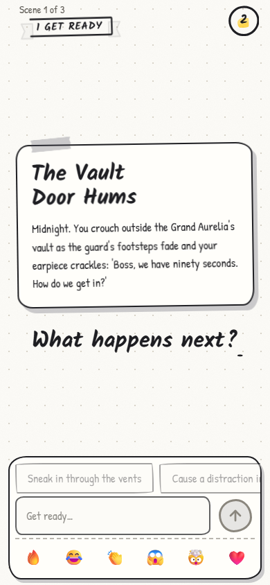
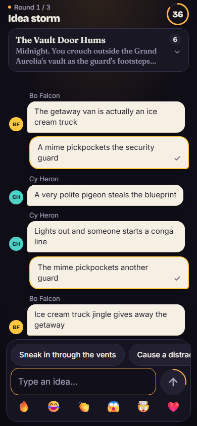
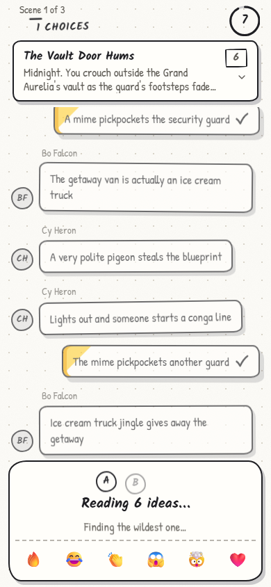
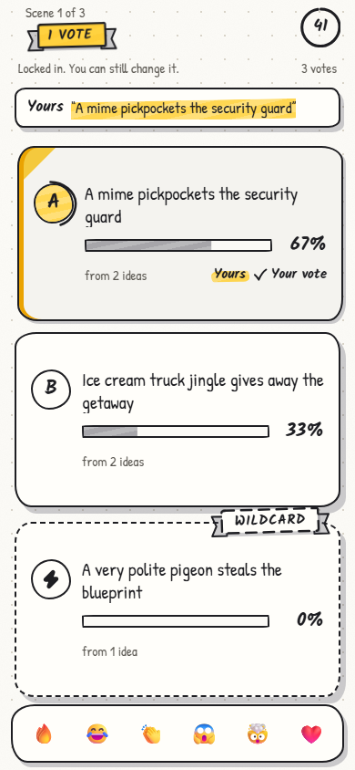
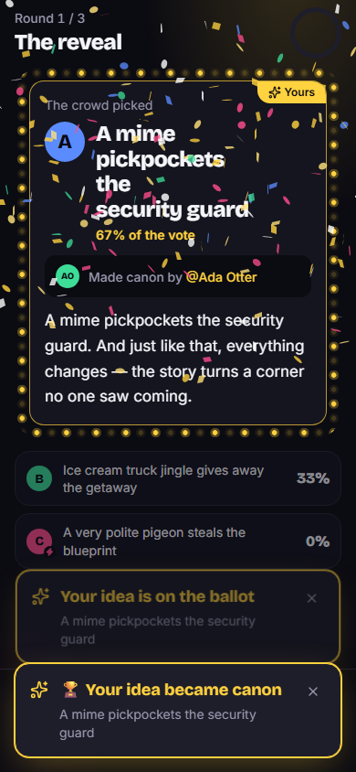
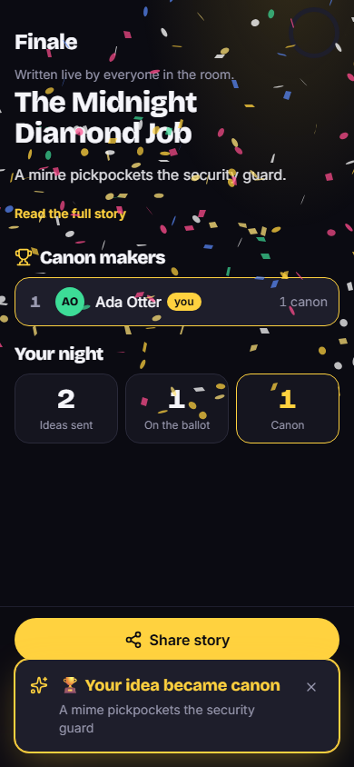
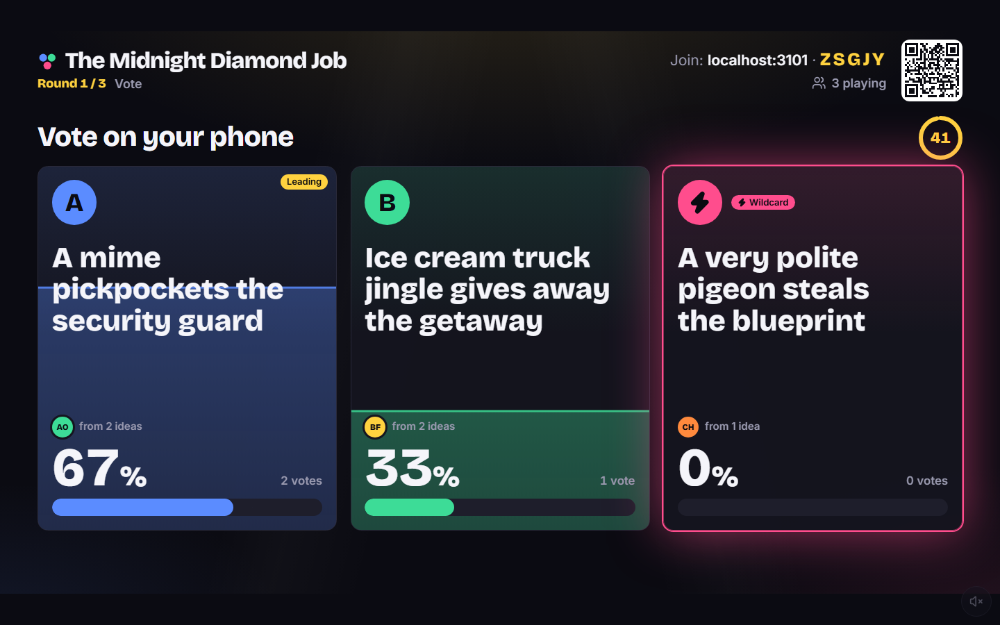
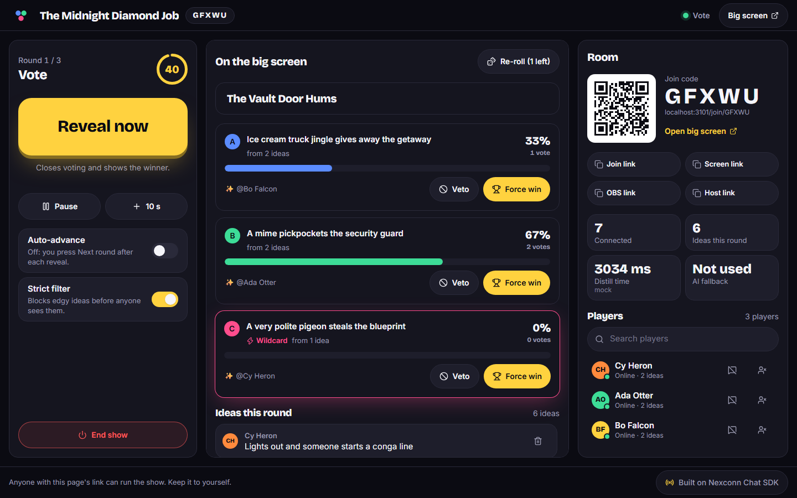
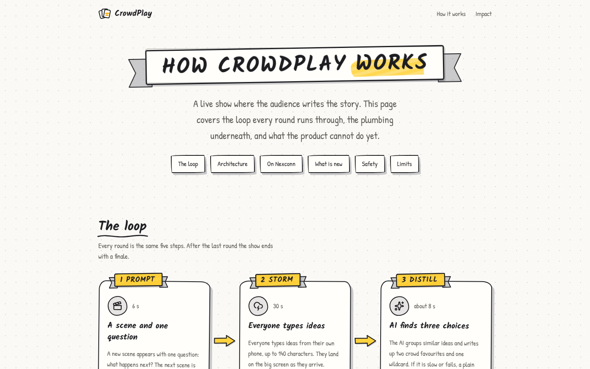

<!--
Export to PDF, 6 pages at most (check the page count after export).
Screenshots are generated by the e2e suite into docs/screens/ as <page>[-<phase>]-<width>x<height>.png.
Image paths below are relative to this file (screens/...); if you export from the repo root, use docs/screens/....
Fields in <angle brackets> are for a human to fill; nothing else here is a placeholder.
-->

# CrowdPlay: the audience writes the show

## 1. One-liner and links

**A live room where everyone types at once, AI turns the storm into three choices written by the crowd (one is always a minority wildcard), the room votes, the story turns, and the people whose ideas were used are credited by name on the screen and on their own phone.** All real-time delivery runs on Nexconn Chat Open Channels. Track: Gaming & Live Streams.

| | |
|---|---|
| Live app | https://crowdplay-rs7o.onrender.com |
| Judge Mode (alone, no host) | https://crowdplay-rs7o.onrender.com/try |
| Repository | https://github.com/Bhavya-Dhoot/crowdplay |
| Demo video | `<add after upload>` |
| Nexconn App Key | `tdrvipkstz5q5` |

## 2. Problem

In a live room of more than about 50 people, chat stops being a conversation: messages scroll past unread. Research on 1.28 billion Twitch messages (Nematzadeh et al., Royal Society Open Science, 2019) found that per-person participation falls as the crowd grows. Today's fixes silence the crowd (slow mode, emote-only mode) or hand control to the host (polls whose options the host wrote). The audience spectates, the host cannot use what the room is saying, and the quiet person with the best idea is never heard.

## 3. Solution

A repeating loop of about a minute, run inside one Nexconn Open Channel. Everyone joins by QR code or a 5-letter code: no signup, just a display name.

| Phase | Default | What happens |
|---|---|---|
| Prompt | 6 s | The narrator sets the scene: "What happens next?" |
| Storm | 30 s | Everyone types ideas (140 characters, one every 2 s). They rain onto the big screen. |
| Distill | up to 8 s (cap 10 s) | AI groups the ideas and writes three options: two from the biggest groups, one wildcard from a small group. |
| Vote | 12 s | One tap each, changeable until time is up. Live bars. |
| Reveal | 12 s | The narrator continues the story and names the contributors ("@priya, @sam + 23 others"). Credited phones get a receipt. |
| Finale | after the last round | Story recap, canon makers, a shareable story page with a preview image. |

<table>
<tr>
<td align="center"><br><sub>Prompt</sub></td>
<td align="center"><br><sub>Storm</sub></td>
<td align="center"><br><sub>Distill</sub></td>
<td align="center"><br><sub>Vote</sub></td>
<td align="center"><br><sub>Reveal</sub></td>
<td align="center"><br><sub>Finale</sub></td>
</tr>
</table>

<table>
<tr>
<td align="center"><br><sub>Big screen (<code>/screen/CODE</code>), also an OBS overlay with <code>?obs=1</code></sub></td>
<td align="center"><br><sub>Host console: control, live feed, room</sub></td>
</tr>
</table>

Around the loop: a setup wizard with six story presets (Heist, Fantasy Quest, Space Mission, Murder Mystery, Classroom "What if?", Custom), a host console (pause, +10 s, end storm, veto, re-roll once, force win, mute, ban, delete idea), and Judge Mode (`/try`), where a judge alone on one device plays a whole three-round show against 30 simulated players, always labelled 🤖.

## 4. What is new

1. **Options written by the crowd, in seconds.** Nobody scripts the choices. The AI reads what the room typed, groups it, and words three options from those ideas. Supporter counts and credits come from the database, never from the model.
2. **A guaranteed minority slot.** One option is always a wildcard taken from a group holding 15% of the ideas or fewer (or the smallest group), so a strange idea from a few people can still win.
3. **Personal receipts.** If your idea reaches the ballot or wins, you get a private message ("Your idea is on the ballot", "Your idea became canon") and it stays on your `/me` page.

Comparison, from the project's own prior-art check (15 Nov 2026; competitor features change, so verify before quoting):

| | Twitch / YouTube polls | Slido | Remesh | CrowdPlay |
|---|---|---|---|---|
| Who writes the options | The host, in advance | The host (polls); audience questions are ranked by votes | A researcher asks; AI groups the answers | The crowd, via AI |
| Free text from everyone, live | No | Q&A and word clouds | Yes, for analysis | Yes, 140 characters |
| Result drives a live story | No | No | No (analysis, not co-creation) | Yes: the winner becomes the next scene |
| Guaranteed slot for a minority idea | No | No | No | Yes |
| Personal credit and receipt | No | No | No | Yes |

## 5. How it uses Nexconn

Nexconn is the only real-time transport in production. The app refuses to start in production with the mock transport. Only two files import Nexconn packages.

| Feature | Nexconn capability |
|---|---|
| Zero-signup join | Server API access-token issue + Web Chat SDK connect |
| The live room | Open Channel (unlimited participants, online-only) |
| Idea storm | Custom message `CP:Idea`, registered as low priority |
| Everyone sees the same phase and countdown | Open Channel metadata + priority `CP:State` |
| Live vote bars | Open Channel metadata `cp_tally` + `CP:Tally` |
| Narrator and bots | Server-sent Open Channel messages from registered users; priority sender list |
| "Your idea became canon" | Direct Channel message `CP:Receipt` |
| Moderation | Open Channel mute/ban lists, profanity word list |
| Server learns about messages | Message webhook (signature-checked, deduplicated) |
| Reconnect banner | Connection status handler |

**Why Open Channels, metadata and priority controls fit.** A show needs one room with an unbounded audience and no per-user history to manage: Open Channels are built for that. Channel metadata is shared state that clients can read and subscribe to (per the SDK types), which suits "everyone sees the same phase and countdown" and live tallies; late joiners also get the current state over HTTP. Priority controls matter because ideas are the bulk traffic and must never crowd out the state that keeps the room in sync: ideas are marked low priority, while state and moderation types and the narrator sender are on the priority lists. Direct messages carry the personal receipts.

**Confirmed live (automated browsers).** Every Nexconn call was written from the installed SDK types and docs, then run against a live app (Singapore data center): the smoke test passed 11/11, and in three full rounds with two headless phones and the big screen, custom `CP:*` messages reached the other clients, phase changes arrived over Nexconn while HTTP polling was off, and the narrator's direct-message receipt reached a phone that never opened that channel. The deployed app (Render, Singapore) passed the same smoke test and played a full Judge Mode show over Nexconn with live AI. Webhook delivery to the deployed URL is not yet confirmed (the URL answers, and rejects unsigned calls); ideas also arrive over HTTP (`INGEST_MODE=dual`), and each risk keeps a fallback (HTTP polling, a text-envelope mode, in-app receipts).

## 6. Architecture

```
 Phones / big screen / host console (Next.js UI + Nexconn Web Chat SDK)
        |  CP:Idea (low priority)       ^  metadata cp_*, CP:State, CP:Tally,
        |  + HTTP POST ideas, votes     |  narrator messages, CP:Receipt (direct)
        v                               |
   Nexconn Open Channel cp_<CODE>  ---- message:send webhook ----+
                                                                  v
 CrowdPlay server (one Node container): route handlers -> idea ingest (filter, limits, dedupe)
   -> round engine (pure state machine, 250 ms ticker, row-locked advance) -> AI pipeline
   -> realtime adapter (the only Nexconn server code)            |
                                                                  v
                                       Postgres (PGlite in dev)   Anthropic + OpenAI
```



<sub>The same architecture, loop and Feature to Nexconn table are on the product's own <code>/how-it-works</code> page.</sub>

- **The engine is deadline-driven and idempotent.** Server time is authoritative; clients render from `phaseEndsAt` plus a measured clock offset. The tick, every state read and the host heartbeat can all call `advance`, and each deadline produces exactly one transition. State lives in the database, so a restart mid-round resumes the show.
- **One `PublicState`, three delivery paths,** merged by highest version: Nexconn metadata, the priority `CP:State` message, and HTTP (polled every 2 s only while Nexconn is disconnected, behind a reconnect banner). Votes go over HTTP (secret, deduplicated, authoritative).
- **Ideas arrive twice on purpose:** as a Nexconn message and as an HTTP post. The webhook and the HTTP path share one pipeline and one dedupe key, so a double delivery stores one idea.

**AI pipeline, with a fallback at every step.**

| Step | Primary | Fallback |
|---|---|---|
| Embeddings (incremental, as ideas arrive) | OpenAI, 2.5 s | Local hashed vectors on a sample of at most 120 ideas |
| Clustering | Greedy cosine, then a merge pass | n/a (local code) |
| Distiller (3 options + backups) | Anthropic fast model, 5 s | OpenAI fast model (3 s), then heuristics: cleaned representative ideas of the two largest clusters plus one small cluster |
| Validation | zod + rules: two crowd + one wildcard, labels at most 70 characters and distinct, wildcard from a small cluster, every source id real | One repair retry if time allows, else heuristics |
| Narration, scene prompts, finale | Anthropic smart model, 4.5 s | Fast model, then a fixed template |

A hard cap of 10 s forces the heuristic path, and the next round's scene is generated during the current reveal, so no external failure can stall a round. Zero ideas give three narrator-written options; one or two ideas are used and the rest are filled by the narrator.

**Latency budget (storm end to options visible).** Targets are the design budget; "mock" numbers come from the load simulation, which has no LLM, embedding or Nexconn latency.

| Step | Budget | Measured |
|---|---|---|
| Flush the last embedding batch | 0.8 s | not measured separately |
| Cluster and build candidates | 0.2 s | not measured separately |
| Distiller LLM | 3.5 s typical, 5 s cap | **live:** 1.89 s and 1.97 s (OpenAI `gpt-5.4-mini`, whole distill step) |
| Validate, save, publish | 0.5 s | not measured separately |
| **Total** | **about 5 s typical, 8 s p95, 10 s hard cap** | **live (2 rounds, small rooms):** STORM deadline → options on the phones 2.8 s and 3.1 s. **Mock / synthetic:** options saved a median 927 ms and p95 1,161 ms after the storm closed (300 simulated senders x 5 ideas over a 30 s storm, 5 rounds, 7,500 ideas, none dropped). |

## 7. Safety

An idea has to get past three layers before it can reach the big screen, and the host can step in at any point.

1. **Word filter at ingest.** A multi-language blocklist (whole-word matching after accent and look-alike folding), link, email and phone-number patterns, spam checks, and Nexconn's profanity list. Public rooms start with the strict filter on. Display names pass the same filter.
2. **AI safety flags and a re-filter.** The distiller marks unsafe clusters (they never become options or credits), and everything a model writes (option labels, narration, finale) is filtered again, with a template used if it fails.
3. **Host control.** Veto any option (replaced from stored runner-ups), re-roll once, force a winner, delete an idea, mute or ban a player. A ban is enforced in the database and in the Nexconn channel.

Also: one idea per 2 s and twelve per round per player (plus per-network limits), and player text is always handed to the models as quoted data to read, never as instructions.

## 8. Real usage

**No public sessions have been recorded yet.** The `/impact` page counts only real people (not bots, not demo rooms, not anyone who deleted their data) straight from the database, and today it says "No real show has been played yet" rather than showing a number. The simulated load test in section 6 is synthetic and is not usage.

How the numbers will be collected: run public sessions of about ten minutes (six rounds) with real communities; the host shares `/screen/CODE` on a call or stream while people play on phones; after each session record `/impact` (people, shows, ideas, canon makers, median and p95 distill time), screenshot the page, save the `/story` link, a phone recording of a receipt, and two or three player quotes asked for in the chat. Counts are copied exactly as `/impact` shows them.

`<Paste the session table, counts and quotes here after the sessions run, or delete this line if there were none.>`

## 9. Business

- **Who pays:** streamers, tabletop game masters, event MCs, teachers and community managers: anyone who hosts a room that is too big to read.
- **Planned pricing (not implemented; v1 has no payments and none of it has been tested with customers):** free up to 50 players; Creator at $12 a month (500 players, OBS overlay, voice); Events at $99 an event (branding, data export, multilingual).
- **Wedges:** Discord community nights, D&D streams, college fests, classroom "what if" lessons.
- **Why it grows Nexconn:** every paid show adds monthly active users and concurrent connections on Nexconn, and the product uses the parts of Nexconn that large rooms need (Open Channels, metadata, priority controls, direct messages). LLM cost per round is roughly flat, because the model sees capped cluster samples rather than every message; embedding cost grows with the number of ideas.

## 10. Honest limits

- **Live, but small.** The live runs used the real Nexconn API and OpenAI with three automated browsers (two phones, one screen) from India to the Singapore data center. Idea delivery was 0.93–1.04 s (one 3.0 s outlier in 14 samples), so the 1 s target holds at the median, not at p95. Crowds, mobile networks and the message webhook (it needs the deployed URL) are not tested yet; the 300-sender load test is mock-only.
- **Capacity.** Nexconn's free plan allows 50 concurrent open channels. The 500 concurrent connections we designed for (rooms stop admitting at 450 by default) assume Chat Growth Credit; the public pages we could read state only 2,000 MAU and a connection allowance of 5% of the MAU tier, so 500 is not confirmed. The load test used 300 simulated senders, not 300 connections.
- **The webhook body is unsigned,** so a captured header set authenticates any body for as long as the timestamp is accepted. We limit the timestamp to 5 minutes, parse strictly, deduplicate, and re-validate every idea as if it came over HTTP. Other clients can forge channel metadata, so browsers use it as a hint and trust only the narrator's messages and the HTTP state.
- **LLM latency is the main risk to the 8 s target;** the fallbacks keep rounds finishing but would show heuristic-quality options.
- **Single instance.** Timers, rate limits and caches live in the server process; the deploy is one container plus Postgres. Two instances were not tested.
- **Smaller items:** TTS audio sits on local disk (off by default); Nexconn tokens are not refreshed during a show; the multilingual and TTS flags have not been run live; `/try` boosts the judge's idea into the wildcard slot (shown as "boosted in demo") and its bots vote at random, so the wildcard does not always win.
- **Not built:** accounts, payments, native apps, video streaming.

## 11. Prior work

No code written before the challenge window was reused. The first commit in the repository is dated **2026-11-17 01:29:43 +0530** and the history after it is the in-window record. A product spec pack (PRD, tech spec, UX spec, AI prompts, build plan) dated 15 Nov 2026 predates the first commit and contains no code.

Dependencies: `@nexconn/chat` and `@nexconn/engine` 26.2.1, `@nexconn/server-sdk` 0.1.2, Next.js 16.4.6, React 19.3.0, Tailwind CSS 4.3.3, Framer Motion, lucide-react, canvas-confetti, qrcode, Drizzle ORM, PGlite, `pg`, zod, jose, pino, nanoid, `@anthropic-ai/sdk`, `openai`, and for tooling TypeScript, ESLint, Vitest, Playwright, tsx and drizzle-kit. Fonts: Bricolage Grotesque and Inter (`next/font`). No bundled image or audio assets.
